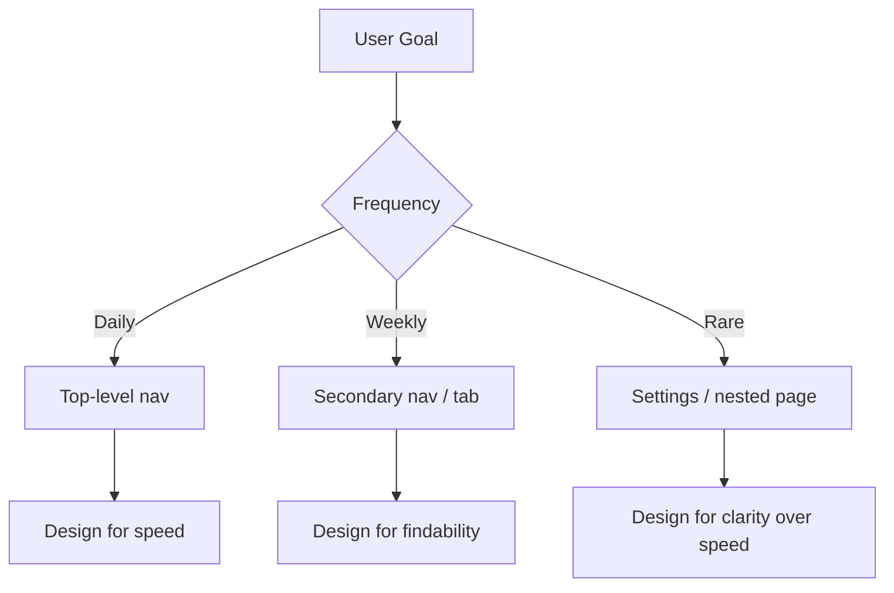
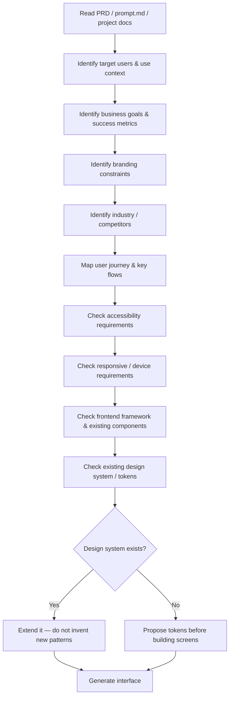

# UI/UX Fundamentals — AI Design Reference

> Permanent design knowledge base. Read this before generating any interface.
> Audience: AI systems and engineers doing software development, not beginners.

## Table of Contents

1. [Design Philosophy](#1-design-philosophy)
2. [User Psychology](#2-user-psychology)
3. [Information Architecture](#3-information-architecture)
4. [Visual Hierarchy](#4-visual-hierarchy)
5. [Typography](#5-typography)
6. [Color System](#6-color-system)
7. [Layout Systems](#7-layout-systems)
8. [Anti-Template Design](#8-anti-template-design)
9. [Components](#9-components)
10. [Mobile UX](#10-mobile-ux)
11. [Accessibility](#11-accessibility)
12. [Motion Design](#12-motion-design)
13. [Design System](#13-design-system)
14. [UX Writing](#14-ux-writing)
15. [AI Design Workflow](#15-ai-design-workflow)
16. [Framework Adaptation by Industry](#16-framework-adaptation-by-industry)
17. [Practical Checklists](#17-practical-checklists)
18. [Anti-Generic Detection Protocol](#18-anti-generic-detection-protocol)
19. [Signature Technique Library](#19-signature-technique-library)
20. [Reference Gathering Process](#20-reference-gathering-process)
21. [Design Movements & Reference Systems](#21-design-movements--reference-systems)
22. [Cultural & Regional Design Grounding](#22-cultural--regional-design-grounding)
23. [Advanced Composition](#23-advanced-composition)
24. [Final Rules](#24-final-rules-for-any-ai)

---

## 1. Design Philosophy

Core axioms — treat as non-negotiable:

| Principle | Meaning | Failure mode if ignored |
|---|---|---|
| Design is communication | Every pixel sends a message; unintentional pixels send noise | User misreads intent, hesitates, or bounces |
| UI serves UX | Interface is the visible layer of a behavioral system, not the product itself | Pretty screens that don't convert or complete tasks |
| Usability > beauty | A beautiful interface that fails to complete the user's task is a failed design | High bounce, low task completion despite good screenshots |
| Every component has a purpose | If you can't state why an element exists, remove it | Visual clutter, slower scanning, higher cognitive load |
| Reduce user thinking | Good design is invisible; users act without deliberating | Decision fatigue, drop-off at friction points |
| Clarity > decoration | Decoration is acceptable only after clarity is achieved | Style masking a broken flow |
| Consistency > creativity | Predictable patterns let users transfer learning across the product | Users must relearn each screen |
| Creativity must serve usability | Novelty is a tool for differentiation, not an end goal | "Awwwards trophy, zero conversions" syndrome |

**Operating rule:** when a stylistic choice and a usability requirement conflict, usability wins unless the product's entire value proposition IS the aesthetic (e.g., portfolio, luxury brand, art platform) — in that case, aesthetics become a functional requirement, not decoration.

---

## 2. User Psychology

| Law / Concept | Definition | Interface implication |
|---|---|---|
| **Hick's Law** | Decision time increases with number/complexity of choices | Limit primary actions to 1 per screen; group secondary options behind progressive disclosure |
| **Fitts's Law** | Time to reach a target = f(distance, size) | Primary CTAs large and close to the point of interaction (e.g., near cursor/thumb); don't shrink tap targets below 44×44px |
| **Miller's Law** | Working memory holds ~7±2 chunks | Chunk navigation into 5–7 top-level items; paginate/group long lists |
| **Peak-End Rule** | Users judge an experience by its most intense moment and its ending | Invest design effort in onboarding peaks and final confirmation/success screens |
| **Progressive Disclosure** | Show only what's needed now; reveal complexity on demand | Multi-step forms, expandable advanced settings, "Show more" |
| **Mental Models** | Users predict behavior based on prior experience with similar products | Match conventions (cart icon = commerce, gear icon = settings) unless you have strong reason to deviate |
| **Recognition vs Recall** | Recognizing an option is easier than recalling it from memory | Use visible menus/icons over commands users must remember |
| **Cognitive Load** | Mental effort required to process an interface | Reduce simultaneous decisions, remove redundant information, use defaults |
| **Visual Scanning / Eye Tracking** | Users scan in F-pattern (text-heavy) or Z-pattern (landing/marketing) | Place key value props along scan paths; don't bury CTAs bottom-right on a text page |
| **Reading Patterns** | Users skim, not read | Use headings, bold key terms, short paragraphs, bullet lists |
| **Decision Fatigue** | Choice quality degrades as choice volume/duration increases | Pre-select sensible defaults; reduce optional fields in forms |

**Application rule:** every screen should answer, within 3 seconds of first glance: *Where am I? What can I do? What should I do next?*

---

## 3. Information Architecture

- **Content hierarchy**: order by user goal frequency, not by internal org chart. What's used daily sits at top-level; what's used rarely goes deeper.
- **Navigation systems**: top nav for breadth (marketing, cross-section), sidebar for depth (apps/dashboards), tabs for context-switching within one entity.
- **Sitemap thinking**: map every screen to a single primary job. If a screen serves two unrelated jobs, split it.
- **User flows**: design the flow (sequence of screens/decisions) before the screens. A flow diagram catches dead ends and redundant steps that a single mockup won't.
- **Primary vs secondary actions**: one primary action per screen (solid/filled button), secondary actions visually subordinate (outline/ghost/text button). Never two filled buttons of equal visual weight.
- **Grouping information**: group by relationship, not by data type. E.g. group order date + status + total together (related to one order), not all dates in one column purely because they're dates.
- **Card organization**: each card = one entity, one primary action, scannable in <2s.
- **Dashboard organization**: most important KPI top-left (F-pattern start), actionable items above passive charts, alerts/anomalies get visual priority over routine metrics.
- **Search-first design**: if the content set is large or unpredictable (e.g. >50 items, user-generated content), default to search/filter, not pure browse.

---

## 4. Visual Hierarchy

Hierarchy is built from six controllable variables:

1. **Typography** (size/weight) — biggest lever for "what to read first."
2. **Spacing** — proximity implies relationship; distance implies separation.
3. **Scale** — larger = more important, but use sparingly (2–3 size tiers per screen max).
4. **Contrast** — color/weight contrast draws the eye before size does.
5. **Whitespace** — not empty space, it's a structural element that groups and rests the eye.
6. **Alignment** — unaligned elements read as errors, even subconsciously.

**Grid systems**: use an underlying grid (8pt spacing scale + 12-column layout grid) even for "creative" layouts — asymmetry should look intentional, which requires an invisible structure underneath it.

**Rhythm**: consistent vertical spacing between sections (e.g., 96px/64px/48px section paddings) creates a reading cadence; irregular spacing feels broken even if each gap looks fine in isolation.

**Focus points**: every screen needs exactly one visual entry point (usually largest text or highest contrast element). Multiple competing focal points = visual noise.

---

## 5. Typography

| Rule | Guideline |
|---|---|
| Type scale | Use a modular scale (e.g. 1.25 ratio): 12/14/16/20/24/32/48/64px. Avoid arbitrary sizes. |
| Font pairing | Max 2 font families: one for display/headings, one for body. A 3rd only for monospace/code. |
| Line height | Body: 1.5–1.6×. Headings: 1.1–1.3× (tighter as size increases). |
| Letter spacing | Slightly negative tracking on large display text (-1% to -3%); slightly positive on all-caps small text (+5–10%). |
| Paragraph width | 45–75 characters per line for readability (~600–700px at 16–18px body). |
| Responsive type | Scale down ratio on mobile, don't just shrink linearly — headlines shrink more aggressively than body text. |
| Serif use | Editorial, long-form reading, luxury/heritage branding. |
| Sans serif use | Product UI, dashboards, dense data, anything scanned rather than read. |
| Decorative fonts | Never for body or functional UI text; only for isolated brand moments (hero word, logotype). |

**Rule of thumb**: if you can't justify a font choice against the content type, default to a proven system font stack (Inter, SF Pro, Geist, or platform-native) — legibility beats personality in >90% of product UI.

---

## 6. Color System

- **60-30-10 rule**: 60% dominant/neutral (background), 30% secondary (surfaces/sections), 10% accent (CTAs, highlights). Prevents color overload.
- **Color psychology**: blue = trust/stability (finance, SaaS), green = growth/success/eco, red = urgency/error, purple = premium/creative, black/gold = luxury. Use as a starting hypothesis, not a rule — validate against brand and industry norms.
- **Contrast**: text-to-background must meet WCAG AA minimum (4.5:1 body, 3:1 large text/UI components).
- **Dark mode**: don't just invert — reduce pure black/white (#000/#FFF); use dark grays (#0A0A0A–#1A1A1A) for backgrounds to reduce eye strain and avoid harsh contrast halos.
- **Semantic/status colors**: define once, reuse everywhere — success (green), warning (amber), error (red), info (blue). Never repurpose these hues for decoration.
- **Accessible color**: never convey meaning by color alone (add icon/text/pattern for colorblind users — ~8% of men have some form of CVD).
- **Avoiding overload**: cap the palette at 1 neutral scale + 1 brand/accent color + 4 semantic colors. More than that fragments visual coherence.

---

## 7. Layout Systems

| Layout | Best for | Notes |
|---|---|---|
| 12-column grid | General web layout flexibility | Standard for responsive breakpoints |
| CSS Grid | 2D layouts (dashboards, galleries) | Use for layout structure, not micro-alignment |
| Flexbox | 1D alignment (nav bars, button groups, form rows) | Use for component-level layout |
| Bento grid | Feature showcases, product overviews (Apple-style) | Mixed cell sizes imply information hierarchy |
| Editorial layout | Blogs, marketing storytelling, case studies | Asymmetric columns, large pull-quotes, generous whitespace |
| Magazine layout | Content-rich marketing pages | Multi-column text, image bleeds, strong headline hierarchy |
| Timeline layout | Process steps, history, roadmaps | Vertical or horizontal, consistent node spacing |
| Card layout | Collections of comparable entities (products, posts) | Uniform card dimensions within a grid; avoid mixed aspect ratios |
| Dashboard layout | Data-dense apps | Sidebar nav + top bar + content grid; prioritize scan-ability over decoration |
| Landing page layout | Conversion-focused marketing | Hero → social proof → features → pricing → FAQ → final CTA |
| Documentation layout | Technical reference | Left nav (structure) + center content (reading) + right nav (on-page anchors) |
| Portfolio layout | Personal/creative showcase | Can break grid rules; personality and asymmetry are appropriate here |
| Admin layout | Internal tools, CRUD-heavy apps | Density and efficiency over aesthetics; persistent sidebar, data tables |
| Responsive layout | All of the above at smaller viewports | Reflow to single column below ~768px; nav collapses to hamburger/bottom bar |

**Selection rule**: layout choice follows content type and user intent — a landing page optimizes persuasion, a dashboard optimizes speed of comprehension. Never default to the same template regardless of use case.

---

## 8. Anti-Template Design

Generic, low-effort patterns to actively avoid — these are not just "generic web design," they are the specific fingerprints of **AI-generated / zero-effort output**, and they are what a client or reviewer will recognize instantly and lose trust over:

- Hero: left text block + right stock illustration (the single most overused SaaS pattern)
- Bootstrap-default component styling (default shadows, default border-radius: 4px everywhere)
- WordPress-template visual language (centered everything, stock photo heroes)
- Predictable 3-column "feature cards with icon on top" sections
- Safe, boring, uniform 24px spacing everywhere with no rhythm variation
- Default box-shadow: `0 2px 4px rgba(0,0,0,0.1)` on every card
- Overused blue-to-purple gradient as a default "modern" signal
- Centered single-column layouts for every single page type

Instead, reach for:

- **Editorial layouts** — asymmetric grids, pull quotes, large image bleeds
- **Bento grids** — mixed-size cells communicating hierarchy visually
- **Oversized typography** — headline as the hero, not an accompanying illustration
- **Creative whitespace** — negative space as a deliberate compositional tool, not leftover space
- **Layering & depth** — overlapping elements, z-index composition, not flat stacking
- **Glassmorphism** — used sparingly, for premium/depth cues, not on every surface
- **Noise textures / grain** — subtle texture to avoid flat, sterile digital surfaces
- **Mesh gradients** — organic multi-point gradients instead of linear two-tone
- **Organic shapes** — blob shapes, irregular dividers instead of hard rectangles everywhere
- **Modern brutalism** — raw typography, high contrast, intentional rawness (for brands wanting edge)
- **Minimal luxury** — extreme whitespace, thin type weights, muted palettes, restraint as a signal of premium

**Rule**: every "creative" choice must still pass the visual hierarchy and usability checks in Sections 1 and 4. Anti-template ≠ anti-usability.

**Note**: the specific list of "avoid" and "AI-fingerprint" patterns in this section decays over time — what's generic in 2026 wasn't generic in 2022 (glassmorphism itself started as a differentiator, then became a cliché). Treat Section 18 as the living detection layer; update it, don't just trust it forever.

---

## 9. Components

Baseline rules per component family:

- **Buttons**: one filled/primary style per screen; disabled state visually distinct (not just lower opacity — also non-interactive cursor); loading state replaces label with spinner, doesn't just disable.
- **Forms/Inputs**: label above input (not placeholder-as-label — placeholders disappear on focus, breaking context); inline validation on blur, not just on submit; group related fields visually.
- **Checkboxes/Radios**: minimum 20×20px visual box even if the tap target is larger (44×44px); always paired with a clickable label.
- **Tables**: sticky header on scroll for >10 rows; right-align numeric columns; zebra striping only for very dense/wide tables, otherwise rely on row hover state.
- **Charts**: max 5–7 data series before switching to small multiples; always label axes; use direct labeling over legends when <5 series.
- **Cards**: consistent internal padding (e.g. 24px), consistent action placement (bottom or top-right), one clear primary action per card.
- **Dialogs/Modals**: reserve for interruptive, blocking decisions only; always include an explicit close affordance; trap focus inside while open (accessibility requirement).
- **Dropdowns**: max ~8–10 visible items before requiring search/scroll; show selected state clearly.
- **Navigation**: current location always visually indicated (active state); max 7 top-level items (Miller's Law).
- **Search**: show recent/suggested queries when empty; debounce input (250–400ms) before firing.
- **Breadcrumbs**: only for hierarchies 3+ levels deep; omit on flat/shallow IA.
- **Tabs**: for switching views of the *same* entity; don't use tabs for unrelated content sections.
- **Accordions**: for progressive disclosure of optional/secondary content, not for primary content the user needs immediately.
- **Sidebars**: collapsible on smaller viewports; persist state (localStorage/session) across navigation.
- **Toasts/Notifications**: auto-dismiss for informational (3–5s), require manual dismiss for errors/actions needing acknowledgment.
- **Loading/Skeletons**: use skeleton screens (shape of the content) over spinners for content-heavy loads >400ms; spinners acceptable for short, indeterminate actions.
- **Empty states**: always explain *why* it's empty and *what to do next* — never a blank void or generic "No data."
- **404/Error pages**: offer a path forward (search, home link, contact) — never a dead end.
- **Success states**: confirm explicitly (toast, checkmark, redirect) — never leave the user guessing whether an action completed.

---

## 10. Mobile UX

- **Thumb zones**: primary actions in the bottom two-thirds of the screen (natural thumb reach); avoid top-corner-only interactive elements on large phones.
- **Touch targets**: minimum 44×44px (iOS HIG) / 48×48dp (Material) with adequate spacing to prevent mis-taps.
- **Safe areas**: respect notch/home-indicator insets (`env(safe-area-inset-*)` in CSS); never place critical controls under system UI.
- **Gesture navigation**: support swipe-back where platform convention expects it; don't override system gestures (e.g. edge-swipe) with custom ones.
- **Bottom navigation**: 3–5 items max, for top-level app sections only (not for page-specific actions).
- **Adaptive UI**: don't just shrink desktop layouts — restructure: convert multi-column to single column, convert hover states to tap states, convert tables to stacked cards.
- **Progressive enhancement**: core functionality must work without relying on hover, right-click, or precise cursor-only interactions.

---

## 11. Accessibility

Non-negotiable baseline (WCAG 2.1 AA):

- **Contrast ratios**: 4.5:1 body text, 3:1 large text (18px+/14px bold+) and UI components/icons.
- **Semantic HTML**: use native elements (`<button>`, `<nav>`, `<label>`) before reaching for ARIA — ARIA is a patch, not a first choice.
- **ARIA**: only when semantic HTML can't express the pattern (e.g. custom combobox); every custom interactive component needs a role + accessible name.
- **Keyboard navigation**: every interactive element reachable and operable via Tab/Enter/Space/Arrow keys; visible focus indicator always present (never `outline: none` without a replacement).
- **Screen readers**: images need meaningful `alt` text (or `alt=""` if purely decorative); form errors announced via `aria-live` regions.
- **Focus states**: distinct, high-contrast focus ring — don't rely on browser default if you override it.
- **Motion reduction**: respect `prefers-reduced-motion`; disable/reduce non-essential animation for users who request it.
- **Accessible forms**: explicit `<label for>` bound to inputs, error messages linked via `aria-describedby`, required fields marked both visually and programmatically.

---

## 12. Motion Design

| Principle | Guideline |
|---|---|
| Purpose | Motion must communicate state change, spatial relationship, or feedback — never decoration alone |
| Micro-interactions | Button press, toggle switch, checkbox check — should confirm the action registered, <150ms |
| Page transitions | Should preserve spatial continuity (where did this element come from/go to) |
| Hover effects | Subtle (scale 1.02–1.05, shadow lift) — avoid large jumps that feel jarring |
| Loading animations | Communicate progress or at minimum "system is working," not just decorative spinners |
| Spring vs ease | Spring physics for direct-manipulation feedback (drag, swipe); ease-out for UI entrances; ease-in for exits |
| Duration | Micro (100–200ms), standard UI transition (200–300ms), larger layout shift (300–500ms). Beyond 500ms feels sluggish for UI. |
| Easing | Avoid linear easing for anything user-facing — it reads as mechanical/unnatural |
| When NOT to animate | High-frequency actions (typing, scrolling lists), data-dense dashboards refreshed often, anything blocking task completion |

---

## 13. Design System

Build in this order:

1. **Tokens** — the atomic values: color, spacing, radius, typography, elevation, motion duration. Store as variables (CSS custom properties / design tokens JSON), never hardcoded per-component.
2. **Spacing scale** — 4px or 8px base unit; scale: 4/8/12/16/24/32/48/64/96px.
3. **Color tokens** — semantic naming (`color-bg-primary`, `color-text-danger`), never raw hex references in components.
4. **Typography tokens** — named scale (`text-xs` → `text-4xl`) mapped to size/weight/line-height triples.
5. **Radius scale** — small set (e.g. 4/8/12/9999px-full), applied consistently by component type.
6. **Elevation** — shadow tokens tied to z-index layers (surface, raised, overlay, modal).
7. **Icons** — one icon set/library only, consistent stroke width and grid size.
8. **Component library** — build from tokens up: primitives (Button, Input) → composites (Form, Card) → patterns (Modal, DataTable).
9. **Naming conventions** — consistent prefix pattern (`Button/Primary/Default`, `Button/Primary/Hover`), matches Figma layer naming to code component naming 1:1 where possible.
10. **Variants & states** — every interactive component must define: default, hover, active/pressed, focus, disabled, loading, error (where applicable).

---

## 14. UX Writing

| Context | Rule |
|---|---|
| Microcopy | Short, specific, action-oriented. "Save changes" not "Submit." |
| Button labels | Verb + object ("Delete project," not "OK" for destructive actions). |
| Error messages | State what went wrong + how to fix it. Never just "Error occurred." |
| Confirmation dialogs | State the consequence, especially for destructive actions ("This will permanently delete 12 items"). |
| Empty states | Explain why it's empty + give a clear next action. |
| Success messages | Confirm specifically what happened ("Invoice #1042 sent to client"). |
| Loading messages | If load >2s, communicate what's happening, not just "Loading..." |
| Tone/Voice | Match brand context: playful for consumer, precise/neutral for enterprise/finance/health. Consistent across the entire product — no tonal whiplash between screens. |

---

## 15. AI Design Workflow

**This is the mandatory pre-design sequence.** Never generate a layout before completing this analysis.

Before writing any UI code, explicitly answer:

1. Who is the user, and what is their skill/context level (novice consumer vs power user/admin)?
2. What is the single most important action on this screen?
3. What existing components/tokens must be reused (never duplicate a pattern that already exists in the codebase)?
4. What device/viewport is primary for this specific screen (mobile-first for consumer apps, desktop-first for admin/dashboard tools)?
5. What accessibility constraints apply (public-facing = stricter than internal tools)?
6. What does "done" look like — is there a success metric this screen should optimize for (conversion, task completion time, error rate)?

**Never**: blindly generate a layout from a generic prompt without grounding it in the above. A generic AI-generated SaaS landing page is a symptom of skipping this step.

---

## 16. Framework Adaptation by Industry

| Industry | Priority | Design signals |
|---|---|---|
| SaaS | Conversion + onboarding clarity | Clean, modern, benefit-led copy, social proof, freemium/pricing clarity |
| Healthcare | Trust + accessibility + calm | High contrast, larger touch targets, low anxiety color (blues/greens), plain language |
| Education | Clarity + progress feedback | Clear progress indicators, gamified feedback, readable typography, low distraction |
| Government | Accessibility + legibility + trust | WCAG AA minimum (often AAA required), high-contrast, minimal decoration, formal tone |
| Crypto/Web3 | Trust (despite volatile reputation) + real-time data density | Dark themes common, data-dense dashboards, clear transaction states, strong security cues |
| AI Products | Explainability + control | Show system reasoning/confidence where relevant, clear human-in-the-loop controls |
| Finance | Precision + trust + data density | Tabular precision, conservative color use, strict semantic color (never ambiguous green/red) |
| Travel | Visual inspiration + booking clarity | Rich imagery, clear pricing/dates, minimal friction checkout |
| Portfolio | Personal expression + memorability | Breaks grid rules deliberately; personality > convention |
| Marketplace | Trust between two user types (buyer/seller) + discovery | Strong search/filter, ratings/trust signals, clear transaction states |
| Dashboard/Admin | Density + speed of comprehension | Compact spacing, data tables, minimal decoration, keyboard shortcuts |
| Landing Page | Persuasion + conversion | Clear value prop above the fold, social proof, single strong CTA path |
| E-Commerce | Product clarity + purchase confidence | High-quality product imagery, clear pricing/stock/shipping info, low-friction checkout |
| Documentation | Findability + reading comprehension | Strong left-nav IA, in-page anchors, code-friendly typography |

**Rule**: never apply a SaaS-landing-page visual language to a government or healthcare product, and never apply a stiff enterprise-admin visual language to a consumer/portfolio product. Industry context overrides personal/default aesthetic preference.

---

## 17. Practical Checklists

### UX Checklist
- [ ] Single primary action per screen is obvious within 3 seconds
- [ ] User flow tested for dead ends
- [ ] Error states designed, not just happy path
- [ ] Empty states designed
- [ ] Loading states designed

### Accessibility Checklist
- [ ] Color contrast meets WCAG AA
- [ ] All interactive elements keyboard-operable
- [ ] Focus states visible
- [ ] Images have alt text
- [ ] Forms have linked labels and error messaging

### Visual Checklist
- [ ] Consistent spacing scale used throughout
- [ ] Max 2 font families
- [ ] Max 1 accent color + neutrals + semantic colors
- [ ] Clear single focal point per screen
- [ ] Grid alignment consistent

### Mobile Checklist
- [ ] Touch targets ≥44px
- [ ] Primary actions within thumb reach
- [ ] Layout reflows (not just shrinks) below 768px
- [ ] Safe areas respected

### Performance Checklist
- [ ] Images optimized/lazy-loaded
- [ ] No layout shift on load (reserved space for async content)
- [ ] Skeleton states for content >400ms load time
- [ ] Animations use GPU-friendly properties (transform/opacity, not top/left)

### Design System Checklist
- [ ] All colors/spacing/type reference tokens, not hardcoded values
- [ ] Component states fully defined (default/hover/active/focus/disabled/loading/error)
- [ ] Naming convention consistent between design file and code

### Consistency Checklist
- [ ] Button hierarchy consistent across all screens
- [ ] Navigation active states consistent
- [ ] Iconography from single set, consistent stroke/size

---

## 18. Anti-Generic Detection Protocol

This is a mandatory pass **after** a screen is designed, before it's considered done. Generic AI output isn't caused by one bad decision — it's caused by defaulting on every micro-decision simultaneously. This protocol catches that.

### The Swap Test
Ask literally: *"If I removed the logo and text, could this screen be dropped into 5 other unrelated products (a CRM, a fintech app, a food delivery app, a fitness app, a note-taking app) without anyone noticing it's wrong?"*
If yes → the design has no product-specific DNA. Redesign the layout structure, not just the colors.

### The Fingerprint Checklist — reject if 3+ apply unmodified
- [ ] Font is the model's reflexive default (Inter/system-ui) chosen without comparing alternatives
- [ ] Palette is a blue-to-purple or teal-to-blue linear gradient with no other reasoning
- [ ] Every card has identical `border-radius: 12px` + identical soft shadow, with no variation by content type
- [ ] Hero = centered headline + subheadline + two pill buttons + abstract blob/mesh background, no other layout considered
- [ ] Icons are generic outline icon-pack icons (not custom, not tied to brand) in a circle badge
- [ ] Section rhythm is perfectly uniform (every section exactly 80px padding, no variation)
- [ ] Feature section is a 3-column grid with icon-top, title, one-line description — the single most repeated AI pattern
- [ ] No content is real — placeholder Lorem-ipsum-adjacent copy instead of writing actual, specific microcopy
- [ ] Nothing about the layout would change if you swapped the product's industry
- [ ] Empty/loading/error states weren't designed at all — only the "happy path" screen exists

### Escape criteria — what actually makes a design specific
1. **One structural decision that's unusual but justified** (broken grid, asymmetric split, non-standard nav position) tied to *this* product's content or brand.
2. **A color/type system derived from something concrete** — brand heritage, photography, cultural motif, material reference — not "a nice-looking gradient."
3. **At least one custom or heavily-adapted visual element** (illustration style, iconography, pattern, texture) that couldn't be copy-pasted from a UI kit.
4. **Copy that's actually written for this product**, not generic SaaS voice ("Empower your workflow. Get started today.").
5. **A layout decision that reflects the actual content hierarchy of this specific screen**, not a generic template poured over whatever content exists.

**Operating rule**: run this checklist mentally before presenting any UI. If a design fails the Swap Test, go back to Section 20 (Reference Gathering) before touching visual polish — the fix is almost never "add more decoration," it's "the structure itself is generic."

---

## 19. Signature Technique Library

Concrete, nameable techniques for injecting product-specific identity. Pick 2–4 per project — using all of them at once is its own kind of noise.

| Technique | What it is | Good for |
|---|---|---|
| Broken-grid asymmetry | Intentionally violate the grid at 1–2 focal points (oversized image bleeding out of its column) | Editorial, portfolio, brand-led sites |
| Index/numbering as design element | Large stylized numerals (01, 02...) as a structural, visible system, not hidden metadata | Process/step sections, case studies |
| Diagonal or angled section dividers | Replace hard horizontal rectangle breaks with cut angles or organic curves | Energetic/consumer brands |
| Split-screen contrast | Two visually opposed halves (dark/light, image/type, dense/sparse) in one viewport | Landing heroes, before/after narratives |
| Duotone / tinted photography | Apply a brand-color duotone treatment instead of using raw stock photos | Unifies inconsistent photography, avoids "stock photo" look |
| Custom cursor / scroll choreography | Elements reveal, parallax, or reorder based on scroll position | Portfolio, storytelling-heavy sites (use sparingly — Section 12 rules on motion still apply) |
| Monospace as accent, not just code | Use a mono typeface for labels, metadata, prices — signals precision/tech without being a code block | Fintech, data products, technical brands |
| Color-blocking | Flat, saturated solid-color panels as section backgrounds instead of white/gray defaults everywhere | Consumer, youth, cultural-brand sites |
| Oversized pull-quotes as layout anchors | A single quote/stat set at 3–5x body size becomes the section's visual anchor | Testimonials, case studies, editorial |
| Generative/organic background pattern | A custom-generated pattern (not a stock "abstract shapes" PNG) tied to brand motif | Brand-forward sites, cultural identity work |
| Art-direct per section | Each major section gets its own micro-layout instead of repeating one card template down the page | Marketing/landing pages — kills the "same block repeated 6 times" feeling |
| Illustrated / custom iconography | Commission or hand-build icons matching brand line-weight instead of pulling from Lucide/Feather 1:1 | Brand differentiation, when budget allows |
| Tonal/textured surfaces | Use warm off-whites, paper textures, subtle grain instead of flat `#FFFFFF`/`#F9FAFB` everywhere | Premium, editorial, heritage/cultural brands |

**Rule**: a technique earns its place only if it serves the content or brand meaning (Section 1). Decoration for its own sake is exactly the trap this whole document exists to prevent.

---

## 20. Reference Gathering Process

Never design from a blank mental default. Before generating layout or visual direction:

1. **Pull 3–5 references that are NOT the obvious competitor set.** If designing a coffee shop site, don't only look at other coffee shop sites — look at editorial food magazines, hospitality brands, packaging design, even unrelated industries with strong art direction.
2. **Extract structure, not surface.** Ask: what's the underlying grid, hierarchy, and pacing of this reference — not "what color did they use." Copying colors is theft; copying structural thinking and reinterpreting it is craft.
3. **Combine, don't clone.** Take the pacing/rhythm idea from one reference, the typographic scale from another, the color logic from a third. A design assembled from one source is a copy; from three+ sources, synthesized, is original.
4. **Ground it back in the brand.** After borrowing structural ideas, re-derive color/type/imagery from the actual brand (Section 22 for cultural brands) — references inform *how* to structure, not *what* to look like.
5. **If no references are available or the project brief doesn't specify direction, ask the user for 1–3 sites/brands they admire before generating** — this single question prevents most generic output at the source.

---

## 21. Design Movements & Reference Systems

A working vocabulary of visual languages to draw from deliberately, instead of drifting into whichever one an AI model defaults to:

| Movement/System | Core idea | Signals |
|---|---|---|
| Swiss / International Typographic Style | Grid-driven objectivity, sans-serif clarity | Strong grid, Helvetica-family type, red/black/white restraint |
| Bauhaus | Form follows function, geometric primitives | Primary colors, circle/triangle/square motifs, geometric sans |
| Japanese Ma (間) | Negative space as active compositional element, not leftover | Extreme whitespace, asymmetric balance, restraint |
| Scandinavian minimalism | Warmth through simplicity, muted natural palettes | Soft neutrals, generous space, functional honesty |
| Modern brutalism | Raw, unpolished, high-contrast, anti-slick | Exposed grid lines, system fonts at scale, harsh contrast |
| Memphis / postmodern | Playful geometric clash, bold clashing color | Squiggles, confetti shapes, saturated palettes (consumer/youth brands) |
| Neo-brutalism (web) | Brutalism softened for product UI — thick borders, flat colors, hard shadows | Bold black borders, offset drop-shadows, no gradients |
| Vaporwave / Y2K revival | Nostalgic retro-digital aesthetic | Chrome gradients, glitch type, pastel-neon mix (niche, use deliberately) |
| Editorial print design | Magazine-informed hierarchy and pacing | Pull quotes, multi-column text, large image bleeds, folio numbers |
| Minimal luxury | Restraint signals premium | Thin type weights, muted tonal palette, extreme whitespace, no clutter |
| Data-viz-driven / dashboard modernism | Density with clarity | Tabular alignment, direct labeling, monospace numerals |

**Rule**: name the movement you're drawing from before designing, the same way you'd name a design system. "This is minimal-luxury with Swiss grid discipline" is a decision. "This looks modern" is not.

---

## 22. Cultural & Regional Design Grounding

Applies whenever a project is tied to a specific cultural, regional, or heritage identity (e.g. Acehnese/Indonesian brand work) rather than a generic global-SaaS audience.

- **Never default to Western SaaS visual language for a culturally-rooted brand.** A coffee brand rooted in Acehnese culture should not visually read identical to a Silicon Valley SaaS landing page — that's a Section 18 failure (Swap Test) at the brand level, not just the screen level.
- **Source motifs from real cultural references, not generic "ethnic pattern" clipart.** Research actual regional textile patterns (e.g. songket, batik motifs relevant to the region), architecture, calligraphy traditions, or craft techniques — reinterpret them as a modern graphic language (simplified geometric extraction), don't paste literal photos of artifacts as decoration.
- **Color meaning is regionally specific, not universal.** Section 6's "blue = trust" hypothesis is Western-centric; validate color meaning against the actual cultural context (e.g. green's association with Islam/nature in Acehnese context vs. generic "eco" association elsewhere).
- **Typography**: pairing a modern grotesque/sans with a single deliberate cultural typographic accent (a calligraphic wordmark, a script reference) reads as intentional heritage branding — using a cultural font for all body text usually hurts legibility and should be avoided (Section 5's legibility-first rule still applies).
- **Language & tone**: if the product serves a bilingual audience (Bahasa Indonesia / regional language / English), define voice and microcopy tone per language deliberately — don't machine-translate UX writing (Section 14) from an English-first draft.
- **Imagery**: prefer real, specific, local photography/illustration over generic global stock photography — a stock photo of a "diverse team in a bright office" reads as more generic, not less, on a locally-rooted brand.
- **Respect over decoration**: cultural motifs are identity signals, not texture filler — if a motif carries religious or ceremonial weight, confirm appropriateness of use in a commercial context before applying it decoratively.

**Rule**: for any brand with a stated cultural/regional identity, cultural grounding is not optional polish — treat it as a functional requirement equivalent to accessibility (Section 11), because getting it wrong actively damages brand trust with the target audience.

---

## 23. Advanced Composition

Beyond the basic grid rules in Section 4 — for when a layout needs to feel deliberately composed rather than assembled from a component library.

- **Modular scale beyond 1.25**: for more dramatic, editorial hierarchy try 1.333 (perfect fourth), 1.414 (augmented fourth), or 1.618 (golden ratio) — the higher the ratio, the more dramatic the size jump between hierarchy levels; reserve high ratios for hero/display type, not body-heavy UI.
- **Rule of thirds**: place key focal elements (hero subject, primary CTA) along the third-lines/intersections of the viewport rather than dead-center — reads as more considered than perfect centering.
- **Dynamic symmetry / diagonal balance**: balance a large element on one side with several smaller elements or dense text on the other, rather than mirroring — asymmetric weight distribution that still feels stable.
- **Negative space as a shape, not a gap**: treat the empty area itself as having a silhouette worth designing (an L-shaped whitespace framing content, not just margin padding).
- **Layered depth without literal shadows**: overlapping content across sections (an image bleeding into the next section, type overlapping a photo edge) creates depth cues beyond `box-shadow`.
- **Intentional tension**: one element that slightly breaks the grid on purpose (an oversized number, a rotated tag, a bleeding image) draws the eye and signals a human, art-directed decision — but only ever one per screen, or it reads as sloppy rather than intentional.

---

## 24. Final Rules For Any AI

Before generating any interface:

1. Read the PRD.
2. Read prompt.md / project brief.
3. Read existing project documentation.
4. Understand the target audience explicitly — do not assume a generic user.
5. Understand business goals and the metric this screen should move.
6. Understand branding constraints (existing palette, tone, logo usage).
7. Follow the existing design system if one exists — extend, don't reinvent.
8. Never default to a generic/templated layout without justification tied to this specific project.
9. Prioritize usability before aesthetics — aesthetics is a layer on top of a working flow, not a substitute for one.
10. Adapt every decision to this project's specific context (industry, users, device, brand) rather than reusing a previous project's patterns.
11. Run the design through Section 18's Anti-Generic Detection Protocol before presenting it — the Swap Test is the fastest sanity check for whether the output has any product-specific identity at all.
12. If the brand has a cultural/regional identity, ground it per Section 22 rather than defaulting to global-SaaS visual language.

**If any of 1–6 are unknown or unavailable, ask for them before generating UI rather than guessing.**